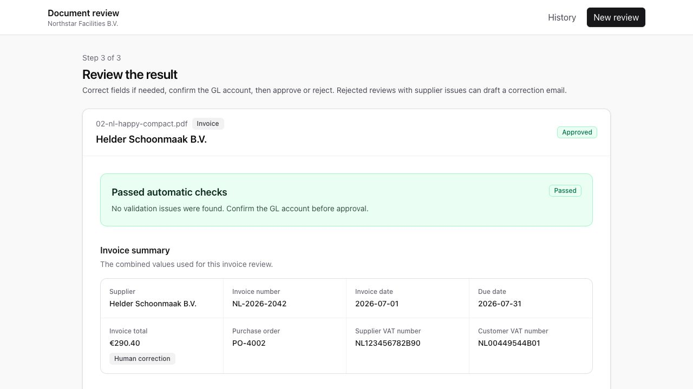
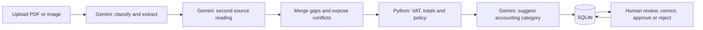

# Invoice Review with Gemini

Learn AI, software and data engineering by running and extending a complete invoice-review application. Upload a fictional invoice or receipt, inspect AI-extracted fields, apply ordinary Python checks, correct mistakes and save a human decision.

This is a learning fork of [Dave Ebbelaar's Invoice Review](https://github.com/daveebbelaar/e2e-invoice-review/tree/solution), adapted to use the **Gemini API free tier**. The original application and fictional corpus remain credited to upstream. This fork adds Gemini adapters, provider-aware review labels and a guided learning path.



## What you will learn

- **AI boundaries:** document understanding, structured output, schema validation, model failures and quotas.
- **Backend engineering:** FastAPI routes, services, provider adapters and ordered pipeline steps.
- **Data engineering:** normalization, decimal amounts, validation, provenance and SQLite persistence.
- **Frontend engineering:** React/TypeScript forms, asynchronous requests, review state and history.
- **Human control:** why model agreement does not prove correctness and why business rules stay in code.



The two readings use the **same model** and may share mistakes. Python validates the extracted values; a person still checks the source. Field confidence is unavailable rather than fabricated. Email drafts are optional and are never sent by the app.

## Quick start

You need Git, **Python 3.12+**, [uv](https://docs.astral.sh/uv/getting-started/installation/), **Node.js 22.12+** and **pnpm 11**. The shell commands below are for macOS/Linux; on Windows, copy the environment files with your editor or PowerShell's `Copy-Item`.

### 1. Get the project

```bash
git clone https://github.com/haiqalzne/invoice-review-gemini.git
cd invoice-review-gemini
```

The default `gemini` branch contains the adapted application. Other branches preserve upstream reference material.

### 2. Configure your own Gemini key

Create or reuse a key in [Google AI Studio](https://aistudio.google.com/api-keys). For free-tier learning, confirm that its project is on **Free tier**. No key is supplied by this repository.

```bash
cp backend/.env.example backend/.env
cp frontend/.env.example frontend/.env
```

Copy these files once; do not overwrite an existing configuration. Edit **backend/.env** privately:

```dotenv
AI_PROVIDER=gemini
GEMINI_API_KEY=replace-with-your-own-key
GEMINI_MODEL=gemini-3.5-flash-lite
```

Keep `frontend/.env` at `VITE_API_BASE_URL=http://localhost:8000`. The key belongs only in the backend. Both `.env` files are ignored by Git.

Use only the included fictional documents: free-tier data may be used to improve Google products. Model availability, eligibility and quotas can change; check [Google's pricing](https://ai.google.dev/gemini-api/docs/pricing) and [your project limits](https://aistudio.google.com/rate-limit). The app cannot enforce your Google billing tier. It does not automatically retry or switch providers.

### 3. Start the backend

```bash
cd backend
uv sync --locked
uv run --locked --no-sync uvicorn app.main:create_app --factory --reload
```

Keep that terminal open. API documentation is at <http://localhost:8000/docs>.

### 4. Start the frontend

Open a second terminal in the cloned project:

```bash
cd frontend
pnpm install --frozen-lockfile
pnpm dev
```

Open **<http://localhost:5173>**, choose **Review a document**, then upload `samples/generated/02-nl-happy-compact.pdf`. Inspect the preview before processing.

For this fictional example, the expected amounts are **240.00 + 50.40 VAT = 290.40 EUR**. AI results can vary: compare them with the source and [sample manifest](samples/manifest.json). History starts empty on a new checkout; the screenshot is an example, not bundled customer data.

A normal upload makes three Gemini requests. An optional correction draft adds one. Local field corrections, validation and decisions make no model calls. Each request has an 8,192-output-token cap and a 90-second timeout.

## Learn in four passes

| Pass | Do this | Evidence you should produce |
| --- | --- | --- |
| 1 · See the whole system | Run one document; inspect fields, issues, category and history. | Explain the journey from file to decision. |
| 2 · Trace one record | Follow the same invoice through the schema, pipeline, rules and repository. | Point to where a value was extracted, checked and saved. |
| 3 · Change and debug | Try an incorrect total, a missing VAT number and a duplicate. | Predict the outcome, then compare with the actual result. |
| 4 · Apply independently | Make one small rule or interface change and verify it. | Explain the change, its evidence and its limitations. |

The [build-along guide](docs/build-along.md) gives file references, worked exercises and troubleshooting. You do not need to understand every line before seeing the app work.

## Code map

```text
backend/app/
  config.py             Provider settings and local application configuration
  providers/            Gemini HTTP and structured document/account/email tasks
  pipeline/             Ordered extraction, review, validation and categorization
  documents/            Schemas, pure rules, routes, service and repository
  document_review/      Comparison, gap filling and provenance
  accounting/           Fixed category catalog and valid selections
frontend/src/           React interface, API client and review state
samples/                Thirteen fictional multilingual documents and expected values
playground/             Small scripts for inspecting selected mechanisms
```

Begin with `docs/client-brief.md`, `backend/app/documents/schemas.py`, `backend/app/pipeline/__init__.py` and `backend/app/documents/validation.py`. Start the backend from `backend/` so its local database and uploads stay under the ignored `backend/data/` folder.

To inspect a Gemini pipeline result without the UI, after installing and configuring the backend:

```bash
cd playground
uv run --project ../backend --locked --no-sync python run_pipeline.py
```

This uses up to three Gemini requests and prints structured results; it does **not** save a review or check database duplicates. The other provider-specific playground scripts and corpus evaluators retain their original Azure requirements.

## Verify changes

```bash
cd backend
uv run --locked --no-sync ruff check app scripts ../playground
cd ../frontend
pnpm exec tsc -b --pretty false
pnpm lint
pnpm build
```

Validation so far: one live fictional PDF, correction and approval guards, an unsent Gemini email draft, browser review/history, offline provider/merge checks and lint/type/build checks. This is not a full-corpus accuracy benchmark. See the build-along guide for the exact limits and manual walkthrough checklist.

This is a local learning app. Public GitHub source does not publish a running service. Do not expose the local server or use real financial records as a shortcut to deployment. The original Azure adapters remain available via `AI_PROVIDER=azure` with separate credentials; Gemini mode does not call them.

## Credits and reuse

Original application, scenario and corpus: [Dave Ebbelaar / Datalumina](https://github.com/daveebbelaar/e2e-invoice-review), with the [original tutorial](https://learn.datalumina.com/docs/invoice-review). Gemini adaptation and learning guide: [haiqalzne](https://github.com/haiqalzne).

Upstream did not declare a standalone software license when this fork was prepared. This fork preserves that status and does not relicense the original code. GitHub permits viewing and forking public repositories under its terms; do not assume a broader open-source license. See [GitHub's licensing guidance](https://docs.github.com/en/repositories/managing-your-repositorys-settings-and-features/customizing-your-repository/licensing-a-repository) and check upstream terms before reuse outside that scope.
